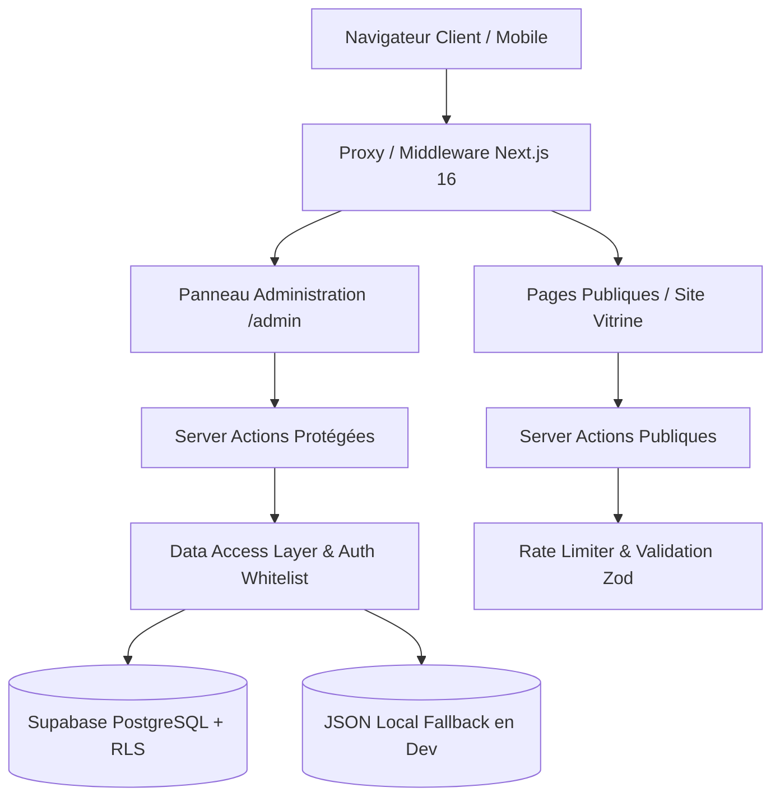

# Architecture Technique - SAMBAFITNESS-V2

## 1. Vue d'Ensemble

L'application **SAMBAFITNESS-V2** est construite sur **Next.js 16 (App Router)** et **TypeScript**. Elle réunit un site public vitrine haute performance pour la salle de sport de Ndioum (Sénégal) et un système complet d'administration et de gestion de salle (membres, présences, règlements, prospects, contenu dynamique).

---

## 2. Piliers d'Architecture

### 2.1 Sécurité & Authentification à Deux Niveaux
1. **Supabase Auth** : Authentification par email/mot de passe ou OAuth Google avec cookies de session sécurisés (`httpOnly`, `sameSite: lax`).
2. **Whitelist en Base (`admin_whitelist`)** : Même si un compte utilisateur existe dans Supabase Auth, l'accès à `/admin` requiert d'être présent dans la table `admin_whitelist` avec le rôle `super_admin` ou `receptionist`.
3. **Guard Server Actions (`requireAdmin`)** : Chaque mutation serveur ré-authentifie la session et vérifie le niveau de rôle minimum requis.
4. **Content Security Policy (CSP)** : Header CSP strict configuré dans `next.config.ts`.
5. **Rate Limiting** : Limiteur en fenêtre glissante protégeant `/admin/login` (5 tentatives / 15 min) et la soumission d'inscriptions (3 / heure).

### 2.2 Stratégie Hybride Local / Supabase (`sync-store`)
Pour permettre à la fois le développement sans connexion Internet à Ndioum et la synchronisation en production :
- Le helper générique `createJsonFileStore` stocke les données dans `data/*.json` en environnement local de développement.
- En production (`NODE_ENV === "production"`), les données sont exclusivement persistées dans **Supabase** sous Row Level Security (RLS).
- La fonction `runSupabase` encapsule les appels distants avec repli gracieux et journalisation structurée.

### 2.3 Découpage Modulaire de l'Administration
Le panneau d'administration (`AdminDashboard.tsx`) est découpé en modules spécialisés (< 300 lignes pour le point d'entrée principal) :
- **Composants d'onglets** : `GymOverviewTab`, `GymMembersTab`, `GymPaymentsTab`, `GymAttendancesTab`, `GymRelancesTab`, `LeadsTab`, `ClubInfoTab`, `PlansEditorTab`, `CoachEditorTab`, `FaqEditorTab`.
- **Modales dédiées** : `QRScannerModal`, `MemberBadgeCardModal`, `ConvertLeadModal`, `ChangePasswordModal`.
- **Hooks personnalisés** :
  - `useAdminData` : agrégation et chargement asynchrone des membres, règlements, statistiques et prospects.
  - `useAdminActions` : orchestrateur des mutations CRUD et liaisons vers les server actions.
  - `useAdminFeedback` : gestion centralisée des notifications toast (succès, avertissement, erreur).

### 2.4 Journalisation Structurée (`lib/logger.ts`)
Remplacement intégral des `console.*` par **Pino** :
- Sérialisation JSON normalisée en production.
- Filtrage intelligent des logs de debug et d'information pour éviter les fuites de données dans le navigateur.
- Prise en charge des stack traces et métadonnées d'erreur.
